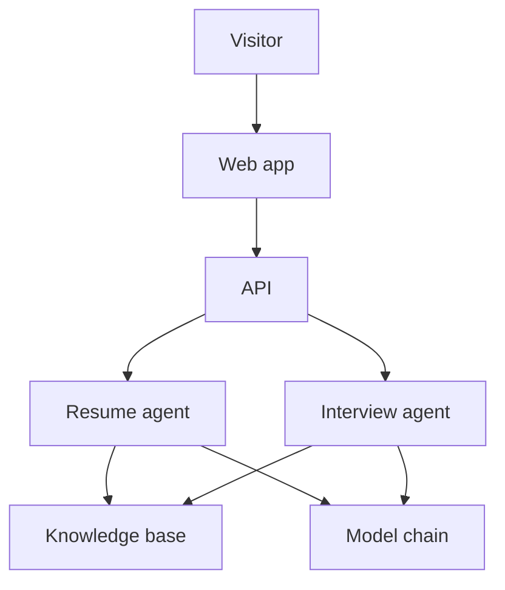

I wanted a portfolio that does more than sit there, so I built one that answers questions. A visitor pastes a job description and gets a resume tailored to it. Then they can chat with an AI interviewer that answers as me, using only entries I wrote about my own experience.

The idea was mine. I designed the system and built it with help from AI coding agents, mostly over three intense days in February 2026. It runs on my machine and I've used it end to end, but it isn't deployed publicly yet. The entries themselves stay private, so this post is about the design.

## Why a portfolio like this

A resume is a flat document. It can't show how I think, and the reader has to guess which parts matter for their role. Demonstrating hands-on work in an interview is awkward too. So I wanted something a visitor can try: paste the job you're hiring for, see what matches, then ask questions and get answers grounded in real material instead of generic claims.

## How it fits together

The web app talks to one API. The API has two agents, one for resumes and one for the interview. Both look things up in the same knowledge base and both call the same chain of language models.

The knowledge base is a set of short structured entries: a title, a description, a list of skills, a category and a line about impact. Each entry is turned into a vector by an embedding model and stored in Postgres with the pgvector extension, hosted on Supabase. Small structured entries are easy to retrieve, rank and count, and that's how the skill chart works.

When a visitor pastes a job description, the API hashes it, embeds it and checks a cache at the same time. It then asks the database for the closest entries, counts the skills across them for the chart, and gives the entries and the job description to a language model with one strict instruction: use only the provided experience and never invent anything. The result is cached under the hash, so the same posting doesn't need a second model call. For now the cache never expires.

The interview works a little differently. For each question the API retrieves the five closest entries and attaches them to the question, but only in the copy it sends to the model. The stored chat history keeps the plain question, so the history stays small and the context is fresh on every turn. Answers stream back over server-sent events, and sessions live in memory for an hour.

Four model providers (GLM, DeepSeek, Claude and GPT-4o) sit behind one interface. The order starts with the free one and falls through to the others when a call fails or times out, and the visitor can pick a model. Around that there are request IDs on every response, a sliding-window rate limit, limits on input length, JSON logs and a health check that says "degraded" when something is missing.

The front end is Next.js with React and Tailwind: a page for the resume, a page for the interview and an about page. I wrote a small stream parser myself instead of adding a chat library. It worked, and the library wasn't worth the refactor.

## Design choices and where it's thin

Every capability extends one small base class, so a new tool is a new agent plus a new page. The design lists more plugins than I built: voice control, a router between agents, document Q&A and permission tiers exist on paper, and only the resume and interview agents exist in code.

Free model first keeps a demo cheap. Context added only to the last message keeps the history clean. A cache keyed on the job description saves model calls.

Where it's thin is everything around the happy path. The normal flows are built, the failure paths are only partly handled, and there are no automated tests. More on that below.

## Building it with AI agents

I split the work into phases. A builder agent kept a memory bank of decisions, changes and open issues, and after each phase another AI agent reviewed the result against the plan.

That worked until it didn't. One review scored a phase at 67% because it had graded two tasks nobody asked for, tests and retry logic. A second pass against the actual request corrected the score to 100% of what I'd asked for. A later review compared 36 planned polish items with the code and found 29 done and 7 skipped, each with a file as evidence.

The same story shows the weakness. Nobody had asked for tests, so there are no automated ones, even though the builder's own rules say to keep coverage above 80%. I tested it by hand. A rule that nothing checks is just a wish.

## What's next

- **Automated tests.** There are none. This comes first.
- **Smaller problems I found by running the backend against fake providers.** A model that fails halfway through an answer can leave a partial answer followed by a second one. A failed chat can be saved as an empty reply. The search endpoint should cap what it returns and sit behind some access control. None of these is fixed yet.
- **Public deployment, and the planned extras:** voice control and the other tools in the design.
- **Measuring the answers.** "Use only the provided experience" is an instruction to a model, not a guarantee, and I haven't measured how well it holds.

## What I took from it

Retrieval over small structured entries turns a resume into something you can query. Fallback across models needs a rule for half-finished answers, not only for failures. AI reviewers can grade generously and even invent work, so check a review against the request. And a rule needs a test that enforces it.

If you're skimming for skills: full-stack development, retrieval-augmented generation, streaming APIs, API hardening, working with AI coding agents, and reviewing AI-written work.
