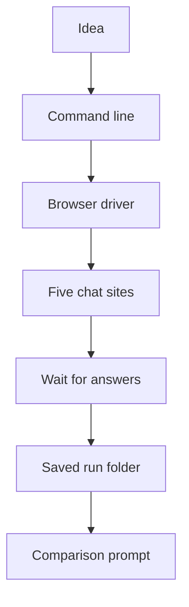

When I have a rough idea, I like to ask more than one AI about it. The answers differ more than I expected, and the gaps between them are often the useful part. Doing that by hand means five tabs, five pastes and a lot of copying afterwards, so I wrote a tool called idea_ai_aggregator to do it for me.

The idea was mine. I built it with AI coding agents, over two days in April 2026. It runs on my own machine and I've used it that way, but it was never deployed anywhere else. This post is about how it works and where it's weak.

## What it does

You type one idea, or point it at a text file. The tool opens ChatGPT, Claude, DeepSeek, Gemini and Perplexity in a browser window, sends the same idea to each (one provider gets a short instruction prefix from the config), and waits until all five have finished answering. Then it saves everything into a folder named after the time of the run: the prompt, one markdown file per assistant, and a JSON file with all the answers together.

A second command reads that folder and writes a ready-made comparison prompt. It asks for the approaches to be compared, strengths and weaknesses weighed, the best parts merged into one proposal, the gaps named, and next steps suggested. I paste that into whichever assistant I like to get the final write-up. A third command opens the browser so I can log in to each service once.

In short: the command line drives a browser to five sites, waits, saves the run, and a second command writes the comparison prompt.

## How it works

I used the browser instead of the providers' APIs on purpose. I already have logged-in accounts on these sites, I don't subscribe to their APIs, and I didn't want five API keys and five bills for something I run now and then. The tool uses Playwright, a browser automation library, with a persistent Chromium profile. I log in once and the sessions are reused. The browser window stays visible, because that is how the logins keep working.

Each site is described in a config file: its address, a few page selectors that say where to type, where to click and where the answer appears, and some timing values. The code has no per-site branches. Adding a sixth assistant should be a new block of config, and fixing one that changed its page is usually an edit to a selector. Not always: the scraper has some fallbacks for page shapes I met, so a big layout change could need a code edit.

The waiting logic is the part I thought about most. Answers stream in, so there's no single moment where a page says it's done. The tool polls each page once a second and treats an answer as finished when its text has stopped changing for three checks in a row. If the text is still short, under a configurable minimum, it waits for ten checks instead, so a "thinking" placeholder isn't mistaken for the answer.

When a site finishes, the tool collects the whole conversation, not just the last message. Some of these pages only keep the messages near the screen in the page, so it scrolls from top to bottom in steps and gathers what it sees, then puts the messages back in order. After that it keeps the browser open and re-reads every few seconds until I close it. If I carry on the conversation, the follow-ups end up in the files as well.

## Design choices

Config over code, for the reason above. A visible browser over headless, so logins persist. A plain-text comparison prompt instead of a built-in summary step, so I choose which assistant writes the final answer and the tool stays small. The whole thing is five short Python modules and a config file, and it is about 600 lines of code.

## Where it's thin

When I reviewed it for this post, the logic was run against fake pages and fake sites, and the real scrolling collector against a small test page. The five real sites I've only used by hand. That gap matters, because selectors on someone else's web page are fragile. When a site changes its layout, that one provider breaks until I fix the config.

Other things I found when I read it again with fresh eyes:

- **There is no overall timeout.** The wait limit only counts checks where no answer has shown up at all. If an answer keeps changing, the tool waits forever.
- **A short placeholder that never changes can be saved as the final answer.** Re-reading afterwards usually fixes it, but the first save is wrong.
- **Identical messages collapse into one.** If I send "continue" twice, the second one disappears from the saved conversation.
- **A failed provider is skipped quietly.** It's marked as an error in its file and left out of the comparison, which is what I want, but a provider that answers with nothing is kept in.
- **Two config values do nothing.** The README says to tune one of them, and the code never reads it. The README also says tabs open in parallel, and in practice they open one after another with a short pause.
- **There are no automated tests and no CI.** The checks above came from throwaway scripts, not a test suite.

## A note on what this is

It drives the normal web pages of these services through my own logged-in browser. That's convenient, and it's also something the services' terms may not welcome, so I treat it as a personal experiment. I'd use the official APIs if I turned it into something other people rely on.

## What's next

- **Tests.** A fake chat page and a test that runs the whole flow against it would cover most of the problems above.
- **A real timeout and a fix for repeated messages.**
- **Keeping session data out of version control.** The browser profile holds logins, so it belongs outside the repository.
- **API mode for the providers that offer one,** with the browser as a fallback.
- **Generating the final proposal itself.** The code comments promise this and nothing does it yet.

## What I took from it

Waiting for a streaming answer needs its own rule, because "done" isn't something the page tells you. Keeping site details in config makes a brittle part cheap to repair. And a README drifts from the code unless something checks it, which is the same lesson as the tests.

If you're skimming for skills: Python, browser automation with Playwright, command-line tools, working with several AI services, and building with AI coding agents.
