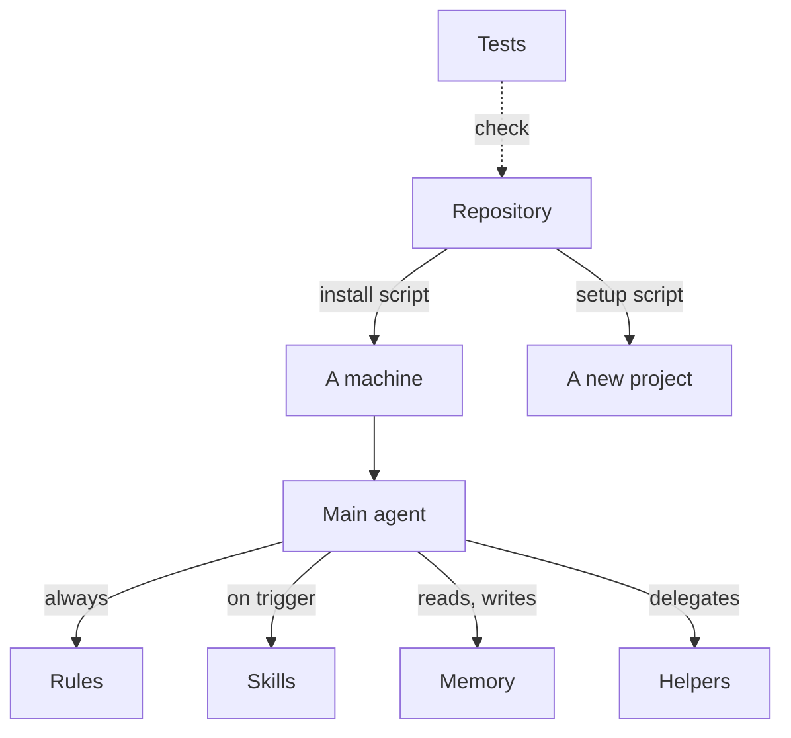

kiro-agent-harness is a pile of plain text files and shell scripts that configure a command-line coding agent, Kiro CLI. Every session starts with the same rules. Each helper agent gets only the tools its job needs. Workflows run when I ask for them, and notes carry over from one session to the next. One script installs the whole thing, another sets it up in a new project, and 170 automated checks keep the files honest.

I designed it from a study of 15 public projects on the same topic, directed an AI agent to build it phase by phase with a passing test at every step, and had a second agent review the result. That review found 11 problems. Some of them were embarrassing.

## Why bother

Coding agents go wrong in boring, predictable ways, and this project goes after five of them. Rules don't load: I had a custom agent that quietly ignored my rule files, and nothing told me. The agent says "done" without checking anything. A new session forgets what we decided yesterday. Every new project needs the same setup typed in again. And on a machine other people also use, an agent with a full shell can wander into folders that hold credentials.

So the goal was simple. Rules that always load, with a way to prove it. Roles with the least access each one needs. Workflows on demand. Memory that survives. A setup I can repeat.

What it isn't: a new agent, or a way to force obedience. The rules are text a language model reads, and the model can ignore them. I only get a hard block where Kiro offers one.

## How it fits together



The repository holds everything, the scripts copy it where it's needed, and the main agent hands work to four helpers: worker, reviewer, researcher and planner.

Five rule files (195 lines in all) load at the start of every session: working principles, evidence before claiming "done", security, documentation standards, and a five-line rule about code search. Then there are ten skills, which are Markdown workflows that load only when a trigger phrase shows up. Eight follow one template: trigger phrases, steps that end in a "verify" line, common mistakes, a definition of done. The two added later follow it loosely. My favourites are a three-critic adversarial review of a plan, and a with-and-without comparison to decide whether a skill earns its place.

Memory is just short notes plus an index. The instruction to write them lives in the most-loaded rule file, because memory doesn't fill itself unless the agent is told to.

To try it, I ran the install script into an empty home folder. It put 25 files in place. The scaffold script then set up a demo project with 5 files. Here's the shape of a helper definition (simplified, not my real file):

```json
{
  "name": "audit-helper",
  "tools": ["read", "code", "shell"],
  "toolsSettings": {
    "shell": {
      "allowedCommands": ["git diff.*", "git log.*"],
      "deniedCommands": ["rm.*", "git push.*"]
    }
  }
}
```

## The choices behind it

I studied first. I started from a written comparison of 15 projects, picked ten techniques and planned three phases. That saved me from inventing rules from scratch. But the techniques came from other tools, so I still had to learn how Kiro really behaves, mostly by trial and error.

Rules are always on, skills wait for a trigger phrase. Things that apply everywhere load every time, and long workflows wait their turn, which saves the agent's working memory. Triggers are fuzzy, though. Two skills both claimed "wrap up" until the review caught it.

Each helper gets the least access it needs. The reviewer has no write tool. The main agent blocks destructive commands (20 patterns now) and credential locations, and a small hook on all five agents refuses any tool call that mentions places like `.ssh` or `.aws`. A block list is never complete. The review showed `rm -fr` slipping past a rule written for `rm -rf`. I'll come back to the reviewer, because I tested it later and it wasn't what I assumed.

The repository is the source of truth. Everything installs from it, and machine-specific files are generated from templates. My first version only mirrored part of my setup: two skills lived on my machine alone.

Every reply has to start with a fixed phrase, a canary. A missing phrase means the rules didn't load. That cheap trick exposed real problems: a `~` in a rule path isn't expanded, and custom agents don't inherit the default rules. I found a third, that the workspace root is the folder you start in rather than the git root, by moving a file and testing again. The canary proves the rules loaded. It doesn't prove the model followed them.

## The review that humbled my tests

After the three phases I had a second AI agent, on a different operating system, review a fresh copy of the repository with none of my machine's state. Each of its 11 findings was checked before I fixed anything. Ten held up fully, one only in part.

The worst was about my tests. They checked the files installed on my own machine, not the files in the repository. On a fresh copy, none of the 140 checks at the time could pass. Meanwhile my own comparison document had scored the project at about 96% against the plan.

The rest were smaller but real: tooling that only worked with GNU tools and broke on macOS, a search command that quietly returned nothing, two different ways to set up a project that disagreed with each other, and documentation that was already drifting.

I worked through all 11 and pointed the tests at the repository. The suite had 148 checks at the first public release and has 170 now. Continuous integration runs it on Ubuntu and macOS, and the latest run passed.

## What it still can't do

The 170 checks test files and scripts: that files exist, JSON parses, text is present, scripts behave in a clean folder. None of them starts the agent. They show the setup is consistent. They don't show the agent behaves better, and I haven't measured that. My notes on how well short and long rules get followed are impressions from daily use. I recorded them as "high" or "medium", not as measurements.

My "read-only" reviewer isn't read-only. I tested it on Kiro CLI 3.5.0, in an empty throwaway folder, with the same permission settings as my real reviewer (without the credential hook). `touch`, which is on neither list, ran. `cat` wrote a file through a redirect. Only the block list held: `mkdir` was refused. My config also lists the shell among the pre-approved tools, which most likely switches the allowlist off. I haven't re-tested without it. Even a working allowlist wouldn't make a helper read-only, since a pattern that allows `find` also allows `find -delete`. Only a helper with no shell at all is read-only for certain.

And the documentation still drifts. My README says the rule files are 179 lines. They're 195. A project about preventing drift isn't immune to it.

## What I took from it

Treat agent configuration like code: test what you ship, not what happens to be installed on your machine. A second reviewer on a different machine finds what self-review and self-scoring miss. Short, specific rules get followed more than long ones, and the most important instruction belongs in the file that loads most often. A permission rule is only as good as its test, and I wrote a "read-only" reviewer long before I checked it. And say what you measured and what you only observed.

Next up is a version for a second agent tool. It's planned, not built.

If you're skimming for skills: system design for AI agents, least-privilege security design, shell scripting, test automation, technical writing, and independent review.

Code and CI results: https://github.com/zhiboluo/kiro-agent-harness
