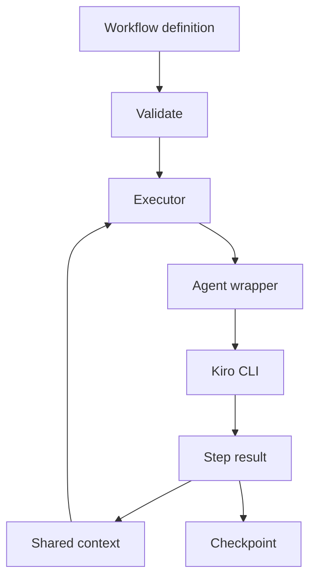

One AI agent doing one job is easy. A review that needs a security pass, then a code-quality pass, then a summary that uses both is harder, because someone has to hand each agent the right input, wait, handle a failure and carry on. In December 2025 I wrote an orchestrator in Python for Kiro CLI that did this. It is now legacy, because Kiro v3 has workflows built in. This post is about how it was designed and what I found when I went back and tested it properly.

The idea was mine. I built it with AI coding agents, from December 2025 into January 2026, and tried it on a handful of test projects. The code is private, so this is about the design.

## What it does

You define a workflow as a list of steps. Each step names an agent, gives it a prompt, and can say which earlier steps it depends on. The orchestrator checks the workflow, runs the steps, and passes each step's output on to the steps that depend on it. A step can also have a condition that makes it run or be skipped.

There are three ways to run it: one step after another, in parallel where dependencies allow, and conditional. Ready-made templates cover a security review, a code review, a refactoring, documentation and testing. A small command line runs a template on a target, and the Python API lets you build your own.

In short: a workflow is validated, then each step runs through an agent wrapper that calls the CLI, and the result goes into a shared context for later steps and into a checkpoint.

## How it works

Each agent is called through the command line with a prompt on standard input. Output has its colour codes stripped before it's stored. Every step result goes into a context manager that has a token budget and gives more weight to steps named "final" or "synthesis", so a long workflow doesn't flood the next prompt. After each step the whole state is written to a checkpoint file, and old checkpoints are cleaned up.

Most of the rest are optional engines that you switch on one by one: an agent pool with health checks, a result cache, a scheduler, workflow versioning, an observer that records events and timings, safety checks on inputs and outputs, planning, reflection on output quality, a human-approval step, a plugin system and a message bus between agents. They map to a catalogue of agent design patterns I was working through. Everything sits in one Python file of about 4,900 lines with 37 classes, and the standard library is enough to run it.

The tool depends on my earlier work. Agents are launched through the launcher script from my memory toolkit, so each one gets its own folder and history. Like the memory toolkit, it's legacy now, for the same reason: the platform caught up.

## What I found when I tested it

The project ships with a README that says "production ready", "289 of 289 tests passing" and "100% coverage". When I reviewed it for this post, I ran the 309 tests in a copy, then ran workflows against a stand-in for the CLI to see what the engine does.

All 309 tests pass. That's the problem, because the checks below weren't caught by any of them.

- **A failed step was reported as a success.** The default recovery strategy is called "retry", but it doesn't retry. It waits and returns a made-up result saying "Retry successful", and the real error is thrown away. I made a step fail on purpose, and the report said one successful step and no failures. Steps that depended on it went ahead. The other three strategies do the same with different text. This is the most serious bug, because the tool's job is to tell you what happened.
- **Every step ran twice.** A misplaced `else` meant that, with the safety checks off, which is the default, each step called the agent a second time and kept the second answer. Two steps made four calls to the CLI. With the cache on, a repeat run still called the agent once per step instead of skipping them. For a tool that spends a model call per step, that doubles the cost and the waiting.
- **Resume wasn't there.** Checkpoints are saved and can be loaded, but the command line's resume option prints that resuming "will be implemented in the next iteration".
- **The coverage number was wrong.** Measured on the main file with the full test suite, line coverage was 65%, not 100%. The test count was also stale: 309, not 289. The badge says 15 of 21 patterns and the text says 20 of 21.
- **Several features were thinner than their names.** The "RAG" engine ranks documents by how many words they share with the query. The tool registry for MCP is a mock. The reasoning engine sends a "think step by step" prompt to an agent.
- **Everything is trusted by default.** Each agent is started with all tools trusted, and a step can run for 15 minutes before it times out.
- **A lot of status paper.** The top level has 43 markdown files, many of them status reports with overlapping names. I didn't read them for this post.

I couldn't verify the claim that it worked in real use, beyond what I ran in a copy with a stand-in agent. The test projects I used it on I haven't re-run.

## What the design got right

Treating a workflow as steps with explicit dependencies was right, and so was keeping every step's output in a shared context with a budget. Per-step timeouts and a checkpoint after each step are the kind of features that matter once a run takes an hour. The three execution modes are small and they work: the parallel mode ran the independent steps first and the dependent one last.

The mistake was building twenty features before making the core trustworthy. Each pattern had its own tests, and none of them tested the thing a user would ask first: "did my workflow succeed?"

## What I'd do differently

- Make failure visible: a failed step stays failed, keeps its error, and stops its dependents unless I explicitly say otherwise.
- Test the executor end to end against a fake agent, including failure and timeout, before adding any optional engine.
- Measure coverage instead of stating it, and put the number in CI.
- Split the single file, and cut the features I never used.
- Default to least privilege for agents, not trust-everything.

## What I took from it

A success flag you can't trust is worse than no flag. A green test suite tells you what was tested, and a README can say anything. And when the platform ships your idea as a feature, the useful part to keep is what you learned about where it fails.

If you're skimming for skills: Python, workflow and agent orchestration, error handling and recovery design, test coverage analysis, and reviewing AI-written code honestly.
