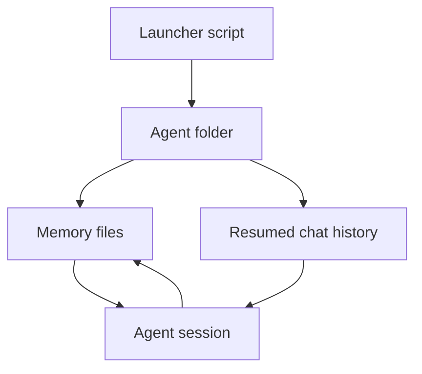

An AI coding agent forgets. Close the chat, and tomorrow's session starts without yesterday's decisions. In early 2026, the AI assistant I use, Kiro CLI, had no built-in memory I could rely on, so I built one on top of it, called the Kiro Context Management System. It worked well in my daily use, and I kept improving it for about ten weeks. It is now legacy, because Kiro has its own built-in memory. This post is about how it was put together and what I learned.

The idea and the design were mine, and I built it with AI coding agents. The code is private, so this is about the design.

## The idea

As far as I could tell, the CLI keeps each conversation under the folder you started it in. That one fact became the foundation. If every agent starts from its own folder, every agent gets its own conversation history, and you can resume it later. On top of that I added memory you can read: plain markdown files that the agent loads at the start of each session and updates as it works.

So an "agent" in my system is a folder:

- `memory-bank/` with five files: decisions, changes, current context, open issues and completed tasks
- `rules/` for the instructions that apply to that agent
- `architecture/` for design notes
- `sessions/` for session summaries
- a JSON config that tells the CLI which files to load and which tools the agent may use

In short: a launcher script starts the agent from its own folder, the agent reads its memory files and resumed history, and it writes decisions back to the files as it works.

## How it works

A launcher script does the important part. It checks the name, makes sure the agent's folder and config exist, copies the config where the CLI can discover it, changes into the agent's folder and starts the CLI with that agent and the resume flag. That's the whole isolation mechanism: a different folder gives a different history.

A create script builds the folder. It asks the CLI to create a base config, then uses `jq` to merge in a role template: the prompt, the resources to load, and the allowed tools. It writes the five memory files with a small metadata header, adds rules, and copies in skills.

There are eleven role templates, for software development, DevOps, testing, security, data science, documentation, research, frontend, backend, mobile and agent creation. Together they carry 29 skills, which are short instruction files for tasks like a code review, a threat model or a test plan, and 16 rule files. A shared steering folder holds project facts that every agent in a workspace reads.

Around that sit the smaller tools: a validator that checks a workspace against what it should contain, a migration script that adds all this to an existing agent without overwriting it, a health report, a script that adds metadata and builds a search index over the memory files, a generated dashboard, and four scripts that publish and sync agents through a shared git repository so the same agent can be pulled on another machine. Fourteen scripts and an installer, roughly 3,800 lines of shell, plus nine documents.

I rewrote it once along the way. An early version had around 37 scripts. When the CLI gained native commands for creating and validating agents, I moved 23 scripts into a `deprecated/` folder with notes on why they were retired, and made the rest call the native commands instead of editing JSON with `sed`. That was the best decision in the project: deleting code that the platform now did better.

## What I found when I tested it

When I reviewed it for this post, I ran the installer, the create, validate, migrate, search and git-sharing scripts in a copy, in a throwaway home directory, with a stand-in for the CLI. The counts in the README (14 scripts, 11 templates, 29 skills, 16 rules, 6 aliases) all came out right. The honest part is what the README says that the code doesn't do.

- **The memory is a request, not a mechanism.** Nothing fills the memory files except the model, because the prompt asks it to. It worked for me, but that rested on the model doing it each time. The `sessions/` folder was empty after creating an agent, and the prompt sends session summaries to the memory folder instead, so as far as I can tell it's mostly unused.
- **"RAG-based retrieval" was wrong.** The README says the resources field does retrieval. My own reference notes say that files loaded this way are always loaded into the context. Every session loads every memory file, and a growing memory costs tokens every time.
- **Search was thinner than described.** Once an index exists, a text query matches entry titles, not their bodies. A word that appears only in the body of a decision was not found. The format examples inside the templates were indexed as four placeholder entries, and the tag index was empty even after I ran the metadata script.
- **The defaults were generous.** Every template pre-approves shell commands and file writes, and eight of the eleven also approve AWS calls, for every agent created from them. That's convenient and it's the opposite of least privilege.
- **Some of it was written for me.** Two of the six aliases point to agents I had made for myself, so on another machine they point at agents that don't exist.
- **The installer needs a script marked deprecated.** It generates the shared rule files by running one from the `deprecated/` folder. Its header says version 3.0 while the README says 5.1, and the README says 23 scripts were retired while the folder's own note lists 19.
- **No tests in the repository.** A set of test scripts exists on my disk, but git ignores the folder, and they drive the real CLI. I didn't run them.

I couldn't verify that it worked well day to day. That comes from my own use, and I haven't re-run it against the current CLI.

## Why it became legacy

Two things ended it. Kiro CLI v3 ships built-in memory, which does the job the memory files did, without a launcher script or a prompt that has to ask for it. And the folder trick depended on how the CLI stored history, a choice I don't control. My own notes from the time record the catch: history is found by the exact folder path, so the same project in a different place on another machine starts a new conversation.

I've since designed a three-layer memory system in a separate project. It builds on what this one taught me, and I'll write it up on its own.

## What I took from it

Build on what the platform gives you, and delete your own code when the platform catches up. A memory that depends on the model remembering to save things is only as reliable as the prompt. Defaults should be strict, because most people never change them. And a README is a promise, so check it against the code.

If you're skimming for skills: shell scripting, working with AI coding agents, designing agent memory and context, templating with jq, and reviewing my own earlier work honestly.
