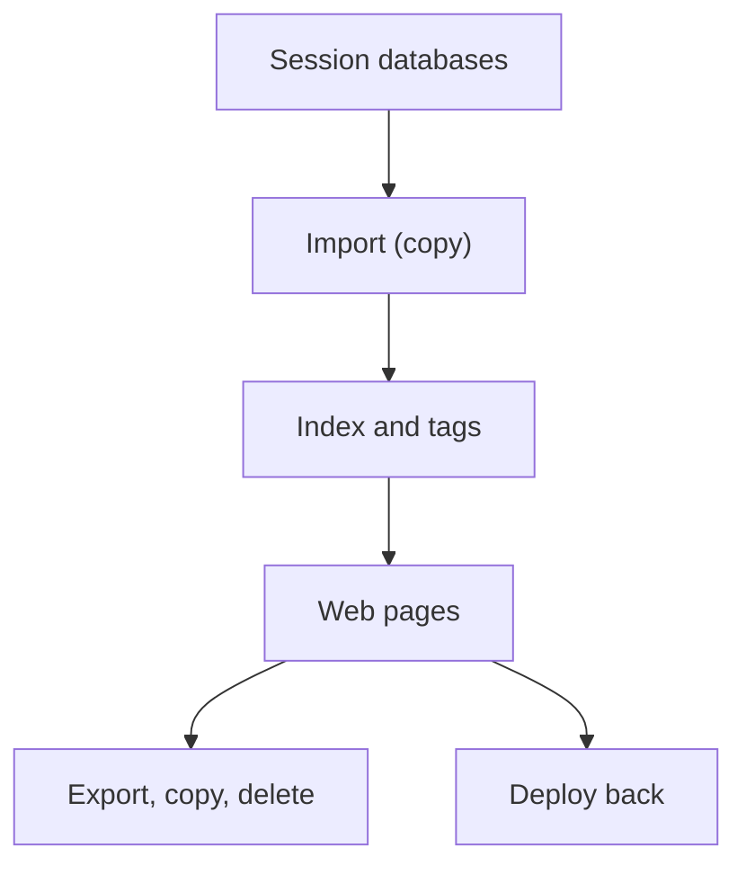

I use an AI coding assistant, Kiro CLI, on more than one machine. Every session I have with it is stored in a local SQLite database, so my history is scattered. I couldn't search across machines, couldn't see what an agent had done last week on the other laptop, and couldn't carry a session from one place to another. In March 2026 I built a prototype called Kiro Memory Manager to fix that.

The idea was mine, and I built it with AI coding agents, in about two weeks. Almost all of the work (48 of 59 commits) happened on two days. It was a prototype for my own use. I don't use it any more, because the CLI changed how it stores sessions and the tool reads the old format. The code is private, so this post is about the design and what I learned.

## What it does

You point it at a copy of a session database, and it imports it with a label like "laptop" or "workstation". From then on you can:

- browse the sessions of each database in a table, filtered by agent, folder, date or tag, with a chat-style view of each conversation
- search across all imported databases with full-text search
- export a session as JSON or Markdown, and import one back
- copy a session from one database to another, rewriting the folder path if the project lives somewhere else on the other machine
- delete sessions, with a backup first
- push a chosen database back into the CLI's own location, again with a backup first

It's a small web app, a dark page with ten templates, behind one shared password.

In short: databases are imported as copies, indexed on the side, browsed in a web app, and optionally written back.

## How it works

The one rule I kept to is that an original is never modified. Import uses SQLite's backup function on a read-only, immutable open of the file, which is meant to work while the CLI has it open. I haven't tested that case. The tool then works only on its own copy. Everything the app adds itself, such as labels, tags, notes, a privacy marker, a backup list and an audit log of every operation, goes into a second small database next to the copies. A full-text index in that database makes search fast.

Each session is one row holding a JSON blob. The tool reads that blob to count messages, take the first prompt as a title, and pull a summary out when there is one. It also guesses the agent name from the folder the session was started in, using the agent folder naming convention. Tags are filled in automatically from the agent, the project folder and a default "private" marker, so a freshly imported history is already somewhat organised.

The stack is Python with FastAPI and Jinja templates, plain SQLite for everything, and no JavaScript framework. I wanted nothing to install except Python, and nothing to run except one process.

Copying a session between databases is the part I like most. A session belongs to a folder path, and the same project often lives under a different path on another machine. So a copy can rewrite the start of the path, and it refuses to proceed when the new path already holds a different conversation.

## What I found when I tested it

The project came with 23 automated tests and a README that said what was done. When I reviewed it for this post, the tests were run in a copy, and the web app and the merge code were driven with fake databases. The README claims more than the code does in a few places, and I found real bugs.

- **A failed refresh empties the stored copy.** If the original file is gone, refresh opens a missing file, SQLite quietly creates an empty one, and the backup step then overwrites the stored copy with it. I reproduced this, and the imported sessions in the copy were gone. The original database wasn't touched, but the whole point of the copy was to survive that.
- **A fresh install doesn't start.** The dependencies are not pinned. With today's version of the web framework, even the login page fails, because the template call changed. It works on the older version I tried.
- **The tests depend on my machine.** Five of the 23 fail on a clean home directory, because the test setup redirects the app folder but the code has already captured the real path. They pass once the folder exists, and they write into it, which a test shouldn't do.
- **Failed imports leave files behind.** A duplicate label or a file that isn't a database is rejected, but the copy was already made and stays in the app folder.
- **Merging into an existing target can crash.** A second merge that keeps both versions of a conflicting session fails on a key that already exists. The merge feature also has no page. It exists in the code and the tests, and the README lists it as a feature.
- **The "privacy" setting is only a label.** A session marked private still shows up for anyone with the shared password, and nothing checks it except the export file, which records it.
- **Login has no limit.** I made 30 wrong attempts in a row and none of them was slowed or blocked. The password is stored as a salted SHA-256 hash, a single round, with no slow hashing.
- **The deploy form takes any path.** Whoever is logged in can name any writable file as the target, and the tool writes a database there. For a tool that sits behind a shared password, that is too much trust.

## Where it was thin

Most of this comes from one fact: I built it fast, with AI agents, and the tests it came with check mostly the normal paths. Nothing tests a failure halfway through, or a fresh environment.

The design held up better than the edges. Copy-then-work-on-the-copy was the right call, and it's the reason the empty-copy bug cost me a stored copy rather than a real database.

## What I'd do differently

- Pin the dependencies, and run the tests from an empty home directory in CI.
- Treat "the source is missing" as an error before opening anything, and write the refreshed copy to a temporary file, then swap it in.
- Make privacy real, with per-user access, or drop the word.
- Restrict deploy to a configured list of targets.
- Read the session format through a small adapter, so the next change to the CLI's storage is a one-file fix instead of the end of the tool.

## What I took from it

A backup you don't test can destroy the thing it protects. A README that says "done" is a claim, so check it against the code. And a tool that reads someone else's file format needs a seam for the day that format changes, because it will.

If you're skimming for skills: Python, FastAPI, SQLite and full-text search, data migration and merge logic, testing and reviewing AI-written code, and working with AI coding agents.
