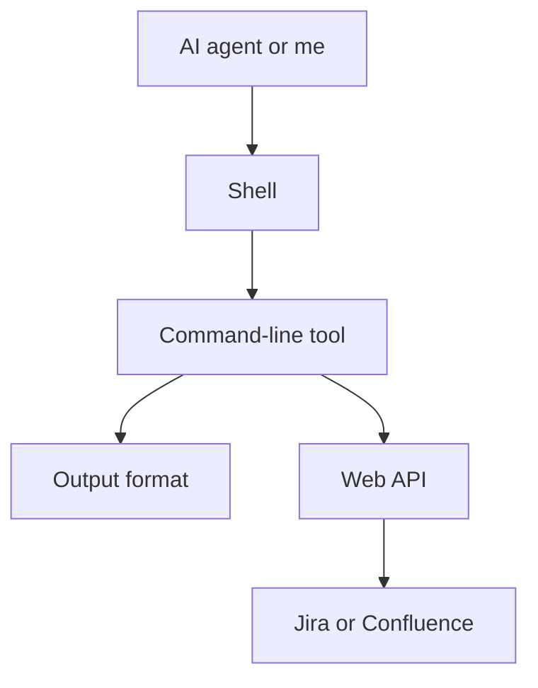

Most of my working day touches Jira tickets and Confluence pages, and an AI coding agent that can't read or update them is only half useful. The usual way to give an agent that reach is an MCP server, a standard plug-in that exposes a tool. In early 2026 those weren't available to me, so I wrote two small command-line tools instead: one for Jira, one for Confluence. An agent can call a command-line tool through its shell, and so can I.

The idea was mine. I built both with AI coding agents in February 2026, and I used them in my daily work. Managed MCP servers have since arrived, which makes the tools legacy. I still use them, including recently, because a managed server isn't always online and a script on my own machine is. The code is private, and it points at an internal company system, so this post is about the design.

## What they do

The Jira tool has 57 commands and the Confluence tool has 14. On the Jira side they cover the daily loop: show my issues, look at one in detail, read comments, search, filter by status or priority, see what changed recently, and a weekly summary and a dashboard. Writing commands cover commenting, assigning, changing status, priority and labels, creating and cloning issues, linking them, attaching a file, and moving an issue to another project.

Confluence is mostly reading. You can search, find a page by title, read a page as text, list spaces, see recent pages, look at a page's history and diff two versions, and export a whole space. The one write is watching or unwatching a page.

In short: the agent runs a command in the shell, the tool calls the web API with a token from a file, and prints the result in a format the agent can read.

## How it works

Each tool is one Python file, built with Typer for the commands, httpx for requests and Rich for tables. The token is read from a file outside the project, and the base address comes from an environment variable. Nothing is stored in the code except defaults.

The design choice I'd defend is the output. Every listing command takes an output option with three values: a Rich table for me, JSON for scripts, and an "agent" format, which is one plain line per result with fields separated by a bar. My reasoning was that a model reads a short plain line more cheaply than a drawn table, and has no border characters to trip over.

The second choice is write safety. Every Jira command that changes something takes an `--explain` flag. With it, the tool prints the exact request it would make, such as the method, the endpoint and the body, and exits without sending anything. Deleting an issue needs an explicit `--confirm`. The idea was that an agent, or I, first asks what a command would do, then runs it. The Confluence tool has a polite client too: it limits itself to four requests a second and waits when the server says it is overloaded.

According to its own README, the Jira tool was first set up as an agent for a different command-line assistant, and the repository still holds a backup of that old configuration next to the Kiro one.

## What I found when I tested them

When I reviewed them for this post, I didn't contact any real server. I ran the tools in a copy with a fake HTTP layer that answered the way a server would, so everything below is about the tools' own behaviour. All of it comes from my own runs or from reading the code.

What held up:

- **The dry run works.** I ran `--explain` on all 16 commands that write, and none of them made a request. Delete without `--confirm` made none either.
- **The agent format is what it says.** One line per issue, with the key, status, assignee and summary.
- **The rate limiter spaces requests correctly.** Five calls took one second, which is four gaps of a quarter second.

What didn't:

- **The safeguard is a request, not a lock.** `--explain` is optional. A caller that skips it writes straight away, and the docs only say "use --explain first". For an agent, that is a convention and nothing more.
- **A partial failure looks like a success.** The bulk status command swallows errors. When one of three updates failed, it printed "Updated 2/3" and exited with code 0, and it never said why. A script or an agent that checks the exit code sees a pass.
- **Search breaks on a quote.** Queries are built with string formatting. A keyword containing an apostrophe produced a malformed query. It's my own token and my own queries, so the harm is a confusing error, but it shows the tool trusts its input.
- **The retry never gives up.** When the Confluence server says "slow down", the tool waits as told and tries again, with no limit. With a server that always answered "slow down", my fake received 975 requests before Python's recursion limit stopped it. With a real server asking for a minute each time, that would be hours of waiting before it failed.
- **No tests.** Neither tool has an automated test, and the dependencies aren't pinned.
- **A lot of paper.** The Confluence tool has about 800 lines of code and 14 markdown files of guides and status notes. The Jira one has demo and recording scripts besides its docs.

I didn't test against real Jira or Confluence, so I can't say how the tools behave on real errors, large results or permissions. That the tools worked in daily use comes from my own use.

## What I'd do differently

- Make safety a gate: writes dry-run by default, and `--yes` to send.
- Give the retry a ceiling and a clear message when it gives up.
- Return a non-zero exit code when any item in a bulk call fails, and print the reason.
- Escape input in queries, and test the tools against a recorded or fake server in CI.
- Keep configuration out of version control, and pin the dependencies.

## What I took from it

When the standard way in isn't available, a small tool the agent can call from the shell gets you most of the value, and a plain output format matters more than I expected. A dry-run flag is useful, but a safety feature that the caller can skip needs to be the default, not an option. And a tool you stop needing is worth keeping for the days the new one is down.

If you're skimming for skills: Python command-line tools, REST API integration, designing tools for AI agents, error handling and rate limiting, and reviewing my own code with fake servers.
